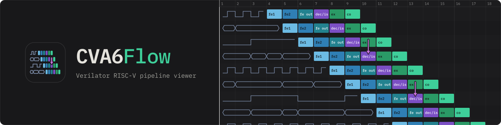
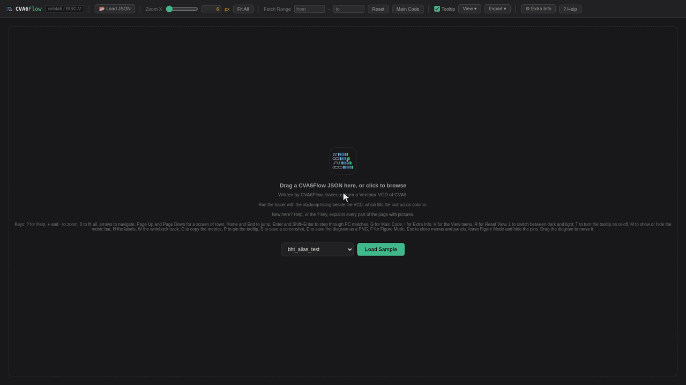

# 

A browser-based pipeline visualiser for the CORE-V CVA6 RISC-V core. It rebuilds the pipeline cycle by cycle from a Verilator VCD of the RTL, and draws every fetched instruction as a row.



**Try it** at [famaf-cva6-project.github.io/CVA6Flow](https://famaf-cva6-project.github.io/CVA6Flow/), the page as the `main` branch has it, with its samples a click away and nothing to install.

## Motivation

A Verilator simulation of CVA6 records every signal, but a VCD shows signals, not instructions. A single daxpy run writes a VCD of about 1.2 GiB in which `wt_valid_i` and `commit_ack_o` toggle without saying which instruction they belong to, or that a load missed the D-cache and held back the rest of the pipeline.

CVA6Flow rebuilds the instruction-level view from those RTL signals, following each in-flight instruction through the core. What it reports falls into three kinds, and each is marked where it is produced:

- **Measured.** Fetch request and delivery cycles, the hand-off from the front end to decode, the issue handshake, writeback, commit, flushes, branch resolution, LSU admission and release, D-cache misses, register dependences and memory writebacks. Each is read from a named RTL signal at a rising clock edge.
- **Derived.** `dec_cycle` equals `fe_out_cycle`, because ID decodes an instruction in the cycle the front end hands it over, and `ex_cycle` is `is_cycle` plus one, because no signal in the VCD marks entry to execute. The tracer labels both where it sets them. Fetch cycles it had to synthesise, for a wrong-path fetch killed before the I-cache answered or a line still cached from an earlier loop iteration, are named in the record's `synthesised_stages`, counted in `metadata.stats.n_ic_records_synthesised`, and drawn with a dashed outline and a `~`.
- **Heuristic.** Binding an I-cache event to the record it fetched, attributing a bubble to its causer, `dc_coalesced`, which rests on the load unit holding one load at a time because the check path carries no source id, the cycle a correct taken prediction redirects in, and the join between a memory writeback and the eviction that caused it. Each is commented where the tracer makes it.

When the VCD lacks a mechanism's signals, nothing is guessed in their place: the fields it feeds stay null or empty, and `metadata.degraded` names it, which the viewer shows as a banner and `-` figures.

## Quick start

Build CVA6 with Verilator and run a test with VCD output enabled. [`scripts/run_CVA6.py`](#running-a-test-scriptsrun_cva6py) does that in one command, and leaves the VCD and the disassembly listing in `results/run/` under the CVA6 root. In the project's [Docker image](#tested-with) the root is `/CVA6`, where every shell starts, the driver is in `scripts/`, this repository's programs in `benchmarks/viewer/` and the viewer in `CVA6Flow/`:

```bash
python3 scripts/run_CVA6.py benchmarks/viewer/daxpy.S
```

Then turn the VCD into the JSON the viewer opens:

```bash
python3 CVA6Flow/CVA6Flow_tracer.py results/run/daxpy.vcd -o daxpy.json
```

From a clone of this repository, name the CVA6 checkout to run with `--cva6-root`, since the driver looks for `/CVA6` and then for a checkout around the script, and the VCD lands in that checkout's `results/run/`:

```bash
python3 scripts/run_CVA6.py benchmarks/daxpy.S --cva6-root /path/to/CVA6
python3 CVA6Flow_tracer.py /path/to/CVA6/results/run/daxpy.vcd -o daxpy.json
```

The **objdump listing is not optional in practice**. It is where the instruction text comes from: without it every record's `disasm` is null, `metadata.disasm_list_path` is null, and the viewer refuses the JSON with that explanation. The tracer picks up `<name>.list` beside the VCD on its own, which is exactly how `scripts/run_CVA6.py` leaves them, and warns when there is none. `--disasm-list` names one anywhere else:

```bash
python3 CVA6Flow/CVA6Flow_tracer.py daxpy.vcd --disasm-list results/run/daxpy.list
```

Then open `CVA6Flow.html` in any browser and drag `daxpy.json` onto the window, or click **Load JSON**, choose its folder once and pick it from the list. There is nothing to install and nothing to serve. The viewer is a single self-contained HTML file with no dependencies, and **? Help**, or the `?` key, explains every part of it with pictures.

### The sample JSONs

The landing page offers the sample JSONs in `tests/`, and this repository commits one per program in `benchmarks/`, so the button works in a fresh clone. A program whose JSON stays under 50 MB has the whole run. A longer one has the records from the start of Main Code, as many as fit under 50 MB, so its sample shows the program's own work rather than its start-up: `bht_alias_test`, `dcache_size_test` and `direct_call_return_test`, and the four that run past the 500,000 records the page renders at once, `commit_ilp_test`, `data_cache_stress_test`, `icache_footprint_test` and `store_miss_test`, about 65,000 records each, cut with `--from` at Main Code's first record and `-i` at what fits. `scripts/make_CVA6Flow_sample.py` trims a full tracer JSON down to one, writing `tests/<source name>.sample.js`, which the page loads, and `tests/<source name>.sample.json` beside it. A sample holds at most the page's `MAX_STREAM_INSTRUCTIONS` records, a limit the script reads from the page. It also keeps `samples.js` beside the sample, a manifest of every sample it wrote there, and warns when that is not the one in `tests/`, since the page loads only `tests/samples.js`. The page loads that one small script whether it is served or opened from disk, so it never lists a folder or parses a sample it was not asked for, and it offers only the samples its own tracer wrote at its own schema version. A sample is listed under its output's name without `.sample`, so `tests/daxpy.sample.js` is offered as `daxpy` and named `daxpy (sample)` once loaded.

```bash
python3 scripts/make_CVA6Flow_sample.py tests/daxpy.json               # -> tests/daxpy.sample.{json,js}, listed in tests/samples.js
python3 scripts/make_CVA6Flow_sample.py tests/daxpy.json -i 1500       # fewer instructions
python3 scripts/make_CVA6Flow_sample.py tests/daxpy.json --from 4000   # start past the set-up
```

## Tracer options

```bash
python3 CVA6Flow_tracer.py <vcd> [-o PATH] [--quiet] [--strict] [--scope-prefix SCOPE] [--disasm-list PATH] [--no-disasm-list] [--config-name NAME] [--emit-diagnostics] [--verbose]
```

| Option               | Meaning                                                                                                                                                                                                                                                                                                                                                                                                                                                                                                                                                                                |
| -------------------- | -------------------------------------------------------------------------------------------------------------------------------------------------------------------------------------------------------------------------------------------------------------------------------------------------------------------------------------------------------------------------------------------------------------------------------------------------------------------------------------------------------------------------------------------------------------------------------------- |
| `vcd`                | The Verilator VCD of a CVA6 simulation (`.vcd`)                                                                                                                                                                                                                                                                                                                                                                                                                                                                                                                                        |
| `-o`, `--out`        | Where to write the JSON. Defaults to the VCD path with its `.vcd` extension replaced by `.json`                                                                                                                                                                                                                                                                                                                                                                                                                                                                                        |
| `--quiet`            | Leave out the progress line                                                                                                                                                                                                                                                                                                                                                                                                                                                                                                                                                            |
| `--strict`           | Exit with 3 when `metadata.degraded` is not empty. The JSON is still written. Use it in batch runs so a degraded VCD is not mistaken for a complete one. A VCD is degraded when a mechanism's signals are missing from it, or when it was cut, holds no value changes, no rising edge, no instruction or no commit, starts part way through the run, or ends at a timestamp that disagrees with its cycle count. A VCD cut exactly at a line boundary is caught by its last commit falling outside the program's exit routine, which needs the listing, and without one can still pass |
| `--scope-prefix`     | The hierarchy the signal table is looked up under. Defaults to `TOP.ariane_testharness.i_ariane.i_cva6`                                                                                                                                                                                                                                                                                                                                                                                                                                                                                |
| `--disasm-list`      | An `objdump -d -S -l` listing of the test, which fills each record's `disasm` by PC. A record outside the listing, the bootrom for one, keeps `disasm` null. Defaults to the VCD's path with `.list` when that file exists                                                                                                                                                                                                                                                                                                                                                             |
| `--no-disasm-list`   | Do not look for a listing, and do not warn that there is none. The viewer refuses the JSON this produces                                                                                                                                                                                                                                                                                                                                                                                                                                                                               |
| `--config-name`      | The CVA6 configuration the VCD was captured on, written to `metadata.config_name` and shown in the Simulation section of the viewer's Extra Info panel. A VCD does not name its own build, so this is a label, not a measurement. Defaults to `cv64a6_imafdc_sv39_hpdcache_wb`. `create_all_CVA6Flow_jsons.py` passes the name of a sweep VCD's configuration                                                                                                                                                                                                                          |
| `--emit-diagnostics` | Also write `lsu_state_history` and `dc_event_log` on every record, which no page reads. Off by default, which keeps a large JSON about 15 percent smaller                                                                                                                                                                                                                                                                                                                                                                                                                              |
| `--verbose`          | Print how each mechanism bound its events to the records, on stderr                                                                                                                                                                                                                                                                                                                                                                                                                                                                                                                    |

The VCD is streamed rather than loaded, because a VCD grows quickly with run length and with how much of the design is dumped, well past what fits comfortably in memory. Informational, warning, error and degraded lines go to stderr, and the closing summary to stdout.

`scripts/create_all_CVA6Flow_jsons.py` converts every VCD in a folder, not recursively, the tracer's folder by default, skipping every VCD whose JSON is up to date, at least as new as the VCD and the tracer and written at the tracer's schema, unless `--force` is given. It converts four at a time by default, each tracer with `--quiet` so their progress lines do not interleave, and prints one line as each VCD starts and one as it ends. `-j 1` lets the tracer's progress line through. It passes `--strict` to the tracer by default, so a degraded VCD makes the batch exit 3 while every JSON is still written, and `--no-strict` turns that off. A conversion that fails outright makes the batch exit 1 instead. `--dry-run`, or `-n`, prints which VCDs would be converted to which JSONs and converts nothing. A VCD with no `<name>.list` beside it is skipped and named, since the viewer would refuse its JSON, and the batch then exits 1 once the rest are converted. The listing is passed to the tracer with `--disasm-list`. A sweep's `<test>.config<N>.vcd` is converted with `--config-name` set to the `CFG_` name of configuration N in the swept package, `configs/cv64a6_imafdc_sv39_hpdcache_wb_config_CVA6Flow_pkg.sv` unless `--config-pkg` names another, and `--config-name` names every VCD's configuration instead.

## Running a test: `scripts/run_CVA6.py`

Getting a VCD out of CVA6 by hand means sourcing the simulation environment, picking the right `cva6.py` flags, and then digging the performance counters out of the log. `scripts/run_CVA6.py` does all of it in one command.

```bash
python3 scripts/run_CVA6.py [target] <test> [--lang auto|c|asm] [--suite config|viewer] [--cva6-root DIR] [--no-vcd] [--keep-build] [--no-keep-sim-output] [--swept-config CFG]
```

| Argument               | Meaning                                                                                                                                                                                                                                                                                                                                                                                                                    |
| ---------------------- | -------------------------------------------------------------------------------------------------------------------------------------------------------------------------------------------------------------------------------------------------------------------------------------------------------------------------------------------------------------------------------------------------------------------------- |
| `[target]`             | CVA6 configuration to build. Optional, and defaults to `cv64a6_imafdc_sv39_hpdcache_wb`, the one the overhead tables were measured on, so another target is warned about                                                                                                                                                                                                                                                   |
| `<test>`               | The test to run: C (`.c`) or assembly (`.S`, `.s`, `.asm`, `.sx`). The type is detected from the extension. A bare name is looked for in this repository's `benchmarks/`, then in `benchmarks/config/`, `benchmarks/viewer/` and `gem5_config_CVA6/CVA6/benchmarks/` under the CVA6 root, and when several hold it the first is run and the others are named                                                               |
| `--lang`               | Force the input type, which selects both the overhead profile and the disassembly markers. Defaults to `auto`, detection by extension                                                                                                                                                                                                                                                                                      |
| `--no-vcd`             | Do not write the VCD, and report metrics only. Use it when you only want the numbers, since the VCD is the expensive part                                                                                                                                                                                                                                                                                                  |
| `--keep-build`         | Reuse the Verilated model in `work-ver` instead of rebuilding it. The model does not depend on the test, so this is the difference between a rebuild and a run when sweeping a set of tests. Only reuse it while the target, the VCD setting, the configuration package and the testbench changes are as they were when it was built, since all four are baked into it. A sweep leaves it built for its last configuration |
| `--cva6-root`          | The CVA6 checkout to run, the one holding `verif/sim`. Defaults to `/CVA6` when it exists, otherwise the checkout this script sits in                                                                                                                                                                                                                                                                                      |
| `--suite`              | Which overhead table to subtract, `config` or `viewer`. Defaults to the `.overhead_suite` file beside the test or up to two folders above it, and the run stops without one                                                                                                                                                                                                                                                |
| `--no-keep-sim-output` | Leave `verif/sim/out_<date>/` in place instead of moving it to `results/verif/` at the end. The batch and the sweep pass it, since they delete the tree themselves                                                                                                                                                                                                                                                         |
| `--swept-config`       | The configuration a sweep installed in the live package, which the sweeps pass. Without it, a live package selecting anything but `CFG_BASELINE`, or a sweep's backup beside it, is warned about, since the run would not measure the production core                                                                                                                                                                      |

What it does, in order:

1. **Rebuilds.** Removes `work-ver` under the CVA6 root so Verilator recompiles the core, unless `--keep-build` says to reuse it. Then sources `verif/sim/setup-env.sh` and runs `cva6.py` against `veri-testharness` with the CVA6 linker script and the `syscalls.c` / `crt.S` runtime. VCD output is enabled through `TRACE_FAST` unless `--no-vcd` is given, and because that is a build-time define, changing it changes the model.
2. **Disassembles.** Runs `objdump -d -S -l` over the compiled `.o` into `<test>.list`, the full listing the tracer wants, and writes only the measured region, from the `MAIN PROGRAM` marker to `FINAL SNAPSHOT` or `END OF MAIN PROGRAM`, to `<test>_report.txt`, between a `DISASSEMBLED CODE` banner and an `END OF DISASSEMBLED CODE` one.
3. **Extracts the metrics.** The test leaves its counter deltas in `s2` to `s10` (`x18` to `x26`) before exiting, and the script recovers them from the simulation log by register.
4. **Prints the table.** Cycles, instructions, I-cache and D-cache misses and accesses, branches, mispredictions plus unpredicted, elapsed microseconds and IPC. Two columns: `OFFICIAL` as measured, and `NET` with the fixed cost of the measurement code itself subtracted, so a short kernel is not swamped by its own instrumentation. The table is appended to `<test>_report.txt` below the disassembly, in its own banner, so the two sections can be told apart at a glance. Its title line names the simulator, the program and the L1 geometry the run used, read from the target's `core/include/<target>_config_pkg.sv`, the next line names the CVA6 target, and the last the CVA6 root and the overhead table. `scripts/measure_CVA6_overhead.py` measures those tables: it runs each suite's empty `test_template` in both languages on the default target, with no VCD and one shared build, prints the profiles beside the ones `run_CVA6.py` carries, and with `--write` puts them into it.

Outputs are written under `verif/sim/out_<date>/`: the VCD and the log in `veri-testharness_sim/`, and the binary, the `.list` and the `_report.txt` in `directed_tests/`. At the end the rest of `out_<date>/` is moved to `results/verif/` under the CVA6 root, unless `--no-keep-sim-output` is given.

The three files worth keeping are gathered in `results/run/` under the CVA6 root, as `<test>.vcd`, `<test>.list` and `<test>_report.txt`, so a run leaves everything the tracer needs in one place. The VCD is moved there rather than copied, since it can run to tens of GiB and a copy would need that much disk again, and the listing and the report are copied:

```bash
python3 CVA6Flow/CVA6Flow_tracer.py results/run/daxpy.vcd -o daxpy.json
```

The `_report.txt` is the readable record of what was measured, disassembly and table together. With `--no-vcd` there is no VCD, so only two files are copied.

The build and the simulation are quiet: everything they write goes to `<test>_run.log` in `out_<date>/`. If the run fails nothing is moved or deleted, and the end of that log is printed.

Which CVA6 checkout it runs is `--cva6-root`: the directory holding `verif/sim`. With no value it uses `/CVA6` when that exists, which is where the Docker image below puts it, and otherwise the checkout this script sits in. It prints the root it chose on every run, and refuses with a message naming the flag when the directory it picked has no `verif/sim` in it. One run goes at a time in a root: every run builds into and reads its `work-ver/`, so a second `run_CVA6.py` started meanwhile is refused.

### A whole folder at once

`scripts/run_all_CVA6_benchmarks.py` runs every benchmark in a folder through `run_CVA6.py`, `benchmarks/viewer` under the CVA6 root when none is given, or this repository's `benchmarks/` when the root has none, skips the templates, gathers the results in `results/batch/` in the working directory, and prints a pass and fail summary. A failed run is kept rather than cleaned, so its output is still there at the end, and an interrupted one counts as failed with code 130. The passing runs' tables are gathered into one metrics file in `results/batch/`, named after the target and the folder, with the suite when given, such as `metrics_cv64a6-imafdc-sv39-hpdcache-wb_viewer.txt`, so a batch of each folder keeps both. Only the first test pays for the Verilator build and the rest reuse it, so a suite costs one build. `--rebuild-each` rebuilds every time, which is what a change to the RTL between tests needs.

```bash
python3 scripts/run_all_CVA6_benchmarks.py benchmarks/
```

### Writing a test

[benchmarks/](benchmarks/) holds the programs written while developing the viewer, and `test_template.c` and `test_template.S` are the starting points. The template configures the PMU (`mhpmevent3` through `mhpmevent8` for cache misses, cache accesses, branches and mispredictions), snapshots `mcycle`, `minstret` and the counters, leaves a `MAIN PROGRAM` / `END OF MAIN PROGRAM` region for your code, and then snapshots again and moves the deltas and the elapsed microseconds into `s2` to `s10`. Write inside the markers and the driver measures and disassembles exactly that region.

## Running the sweep: `scripts/run_CVA6Flow_sweep.py`

CVA6Flow targets the canonical `cv64a6_imafdc_sv39_hpdcache_wb` configuration, and it is built to survive changes to it. Structural parameters are read from the VCD rather than hard-coded: the scoreboard depth, the commit and writeback port counts, and the D-cache set count. A configuration sweep (cache sizes and associativity, branch-predictor or return-address-stack depth, commit width, and so on) is therefore handled without editing the tracer. A build with more scoreboard slots, commit ports or writeback ports than the baseline is refused with the constant to raise, and a superscalar build is refused outright.

[configs/cv64a6_imafdc_sv39_hpdcache_wb_config_CVA6Flow_pkg.sv](configs/cv64a6_imafdc_sv39_hpdcache_wb_config_CVA6Flow_pkg.sv) is the config package the sweep was built with, a modified copy of the upstream one kept beside it as `configs/cv64a6_imafdc_sv39_hpdcache_wb_config_pkg.sv`, and [configs/README.md](configs/README.md) says how the sweep installs a configuration. The swept package carries the seventeen configurations as a table, the baseline, fifteen single-knob cuts and one that cuts every knob at once, each with the workload chosen to exercise it, and a single `CVA6_CONFIG_SEL` that picks the active one:

```systemverilog
  localparam int CFG_BASELINE      = 1;   // no cut, every knob as below      : all
  localparam int CFG_BHT_64        = 4;   // BHTEntries 128 -> 64             : bht_alias_test
  localparam int CFG_SB_2          = 9;   // NrScoreboardEntries 8 -> 2       : daxpy

  localparam int CVA6_CONFIG_SEL = CFG_BASELINE;
```

`scripts/run_CVA6Flow_sweep.py` replays all of it:

```bash
python3 scripts/run_CVA6Flow_sweep.py [--configs 1,4-6] [--tests-dir DIR] [--tests LIST] [--out-dir DIR] [--target T] [--config-pkg FILE] [--live-config-pkg FILE] [--cva6-root DIR] [--suite config|viewer] [--no-vcd] [--dry-run]
```

| Option              | Meaning                                                                                                                                                                                                         |
| ------------------- | --------------------------------------------------------------------------------------------------------------------------------------------------------------------------------------------------------------- |
| `--configs`         | Which configurations to run, for example `1,4-6`. Defaults to every one in the table                                                                                                                            |
| `--tests-dir`       | Where the workloads live. Defaults to `benchmarks/viewer` under the CVA6 root, the folder the Docker image creates, or this repository's `benchmarks/` when the root has none                                   |
| `--tests`           | Comma-separated workloads to run for every configuration, instead of the ones the table names                                                                                                                   |
| `--out-dir`         | Where results are collected. Defaults to `results/sweep_CVA6Flow/` in the working directory                                                                                                                     |
| `--target`          | Architecture target, whose live package the sweep writes over. Defaults to `cv64a6_imafdc_sv39_hpdcache_wb`. A swept package named for another target is refused unless `--live-config-pkg` says where it goes  |
| `--config-pkg`      | The swept package. Defaults to the first `cv64a6_imafdc_sv39_hpdcache_wb_config_CVA6Flow_pkg.sv` found next to the script, in the working directory, in `../configs/` or in `CVA6_configs/` under the CVA6 root |
| `--live-config-pkg` | The package the build reads, overwritten per configuration and restored at the end. Defaults to the target's `core/include/<target>_config_pkg.sv` under the CVA6 root                                          |
| `--cva6-root`       | The CVA6 checkout to run and collect from, forwarded to `scripts/run_CVA6.py`. Defaults to the one `run_CVA6.py` picks                                                                                          |
| `--suite`           | Forwarded to `scripts/run_CVA6.py`: which overhead table to subtract. Defaults to the `.overhead_suite` file beside each workload, and `run_CVA6.py` stops without one                                          |
| `--no-vcd`          | Metrics only, no VCDs                                                                                                                                                                                           |
| `--dry-run`         | Print the plan and exit, touching nothing                                                                                                                                                                       |

For each configuration it installs the package with `CVA6_CONFIG_SEL` set to that variant, then runs that configuration's workloads through [`scripts/run_CVA6.py`](#running-a-test-scriptsrun_cva6py). A configuration whose workload is `all` runs every workload the table names.

Four cuts leave every counter of their workload unchanged, so their rows measure the baseline under another name, as the package notes below its table. `CFG_BTB_4`: CVA6's BTB serves only indirect jumps that are not returns, and `direct_call_return_test` has none. `CFG_DTLB_1`: daxpy runs in M-mode, which translates no address. `CFG_MAXOS_1`: only the standard and write-through D-caches read `MaxOutstandingStores`, and this target builds the HPDcache. `CFG_COMMIT_1`: the second commit port never shortens `commit_ilp_test`'s measured region.

Results are moved out of `results/run/` under the CVA6 root into the out directory as `<test>.config<N>.vcd`, `<test>.config<N>.list` and `<test>_report.config<N>.txt`, so one configuration never overwrites another and the VCD and its listing stay paired for the tracer. Every metrics table is also gathered into one file in that folder, named after the target and the `--configs` selection, with the suite when given, such as `metrics_cv64a6-imafdc-sv39-hpdcache-wb.txt` for the whole sweep and `metrics_cv64a6-imafdc-sv39-hpdcache-wb_1-4-6.txt` for `--configs 1,4-6`, so a second selection into one folder keeps the first's. The file names the swept package at its top, and each table its configuration, such as `config17 CFG_MIX / daxpy`.

Once a run is collected its leftovers are deleted: that test's files in `results/run/`, and its VCD, logs, binary, listing and `_report.txt` in every `verif/sim/out_<date>/` it wrote to, since a run that crosses midnight writes to two. Anything else in those folders is left alone. A run that **fails**, or is interrupted, which counts as a failure with code 130, is the exception: nothing of it is collected or deleted, so its output survives the rest of the sweep, and the sweep exits 1. If nothing failed, the dated folders the sweep wrote to go too.

Two things worth knowing:

- **The live config package is overwritten and restored.** Selecting a configuration means writing the target's package, `core/include/cv64a6_imafdc_sv39_hpdcache_wb_config_pkg.sv` under the CVA6 root by default, so the script backs it up first and puts it back when the sweep ends, fails, is interrupted or is stopped with a plain `kill`. Each run starts in a process group of its own, so Ctrl-C or a `kill` reaches its build and simulation too, and the sweep waits for them to stop before it restores the package. The backup is also kept on disk beside it as `<name>.sweep_backup` while the sweep runs, so a sweep killed outright, with `kill -9` or by a stopped container, leaves it behind, and the next sweep puts the package back from it before it starts.
- **Only the first test of each configuration rebuilds the core.** The RTL changes between configurations, not between the tests of one, so the rest run with `--keep-build`.

Use `--dry-run` first: it prints what each configuration would run, names the closest files for any workload that matches nothing, and calls out configurations left with nothing to run.

## How instructions are recovered

Each in-flight instruction is followed through the core's six stages:

```
fetch -> decode -> issue (allocates trans_id) -> execute -> writeback -> commit
```

Five of those six cycles come from the VCD, and execute is derived. **Decode is the fetch hand-off.** ID decodes the entry the front end hands it in the cycle of that handshake and registers the result for issue, so `dec_cycle` is `fe_out_cycle`. The scoreboard takes the registered instruction one or more cycles later, at the issue handshake, `is_cycle`, and passes it straight on to the operand read, so the forwarding and the register file of each operand are read on that cycle too. `ex_cycle` is `is_cycle` plus one, the cycle the issued operands reach the functional unit: no signal in the VCD marks an instruction entering execute, so it is derived rather than measured. Any comparison resting on the gap between issue and execute is reading the tool's constant, not the core.

The `trans_id` allocated at issue is the handle that makes the rest possible. Writeback arrives on a packed `wt_valid_i` bus with one bit per port and a separate `trans_id_i` signal per port, so a writeback is matched to its instruction by looking up the trans_id of each asserting port. Commit works the same way through `commit_ack_o` and the scoreboard commit pointers.

Every value is read as the VCD holds it after the rising edge, which describes the cycle that starts there: the handshakes, the decoded fields, the forwarding and the writeback bus are all read at that point, which daxpy.vcd confirms against the scoreboard entry of every issued instruction. Within each rising edge the mechanisms run in a fixed order:

1. The perf-counter samples: the I-cache and D-cache request lines, the I-cache miss pulse and the realigner
2. Commit, releasing scoreboard slots, with the scoreboard entry read again
3. Flush detection, a flush at execute also flushing the instructions still waiting to be decoded
4. Writeback, with the scoreboard entry read again
5. Issue, the handshake claiming a slot, with the forwarding and the register file of each operand
6. Fetch, the hand-off to decode
7. The I-cache delivery timeline
8. The load and store unit FSMs
9. The D-cache miss handler's allocations, checks and refill responses
10. The memory writeback handshakes
11. Branch resolution, bound to the oldest unresolved instruction with its PC

Commit runs before the rest of the pipeline on purpose: a slot freed this cycle can be reused the same cycle, and getting the order wrong yields a JSON that looks plausible but is wrong. Decode needs no step of its own, since it is the fetch hand-off, as above.

## The JSON

The tracer writes one JSON, schema 4, with its top-level keys in this order: `metadata`, `config_params`, `instructions`, `ic_events`, `dc_events` and `mem_writebacks`. `metadata` comes first so the viewer can read it before streaming the rest, and the event objects come after the records. `instructions` holds one record per instruction the front end handed to decode, in `id` order, flushed ones included. A record leaves out every key whose value is null, so a missing key reads as null.

Every cycle counts the rising edges of `clk_i` from the first one in the VCD, which is cycle 0, and every value is read as the VCD holds it after the edge. A span of cycles counts them, and an id is another record's `id`. The From column names the signal a value is read from, under `--scope-prefix`.

[MinorFlow](https://github.com/FaMAF-CVA6-Project/MinorFlow)'s JSON names the events the two cores share with the same keys: `fe1_req_lo_cycle` to `fe1_resp_hi_cycle`, `ic_miss_lo` and `ic_miss_hi`, `dec_cycle`, `ex_cycle`, `co_cycle`, `flushed` and `flush_cycle`, `dc_miss` and `dc_coalesced`, `dep_producer_ids` and `dep_producer_regs`, `synthesised_stages`, the pre-fetch wait and bubble keys, `metadata.config_name`, and the `n_records`, `n_committed`, `n_flushed`, `n_unmatched_commits` and `bubbles` counts of `metadata.stats`.

### metadata

| Key                                                                | Meaning                                                                                                                                                                                                                                                                                                                                                                                                                                                    |
| ------------------------------------------------------------------ | ---------------------------------------------------------------------------------------------------------------------------------------------------------------------------------------------------------------------------------------------------------------------------------------------------------------------------------------------------------------------------------------------------------------------------------------------------------- |
| `tool`                                                             | `cva6flow_tracer`                                                                                                                                                                                                                                                                                                                                                                                                                                          |
| `schema_version`                                                   | `4`. Bumped with any key added, removed or redefined, and the viewer and FlowCompare refuse any other                                                                                                                                                                                                                                                                                                                                                      |
| `vcd_path`                                                         | The VCD, as the tracer was given it                                                                                                                                                                                                                                                                                                                                                                                                                        |
| `vcd_scope_prefix`                                                 | The hierarchy the signal table was looked up under, `--scope-prefix`                                                                                                                                                                                                                                                                                                                                                                                       |
| `disasm_list_path`                                                 | The objdump listing the instruction text came from, null without one, which the viewer refuses                                                                                                                                                                                                                                                                                                                                                             |
| `config_name`                                                      | The CVA6 configuration the VCD was captured on, `--config-name` or `cv64a6_imafdc_sv39_hpdcache_wb`. A label, not a measurement                                                                                                                                                                                                                                                                                                                            |
| `clock_period`                                                     | `20000`, in `time_unit`: an assumed 50 MHz                                                                                                                                                                                                                                                                                                                                                                                                                 |
| `time_unit`                                                        | `1ps`                                                                                                                                                                                                                                                                                                                                                                                                                                                      |
| `clock_period_source`                                              | `assumed`, since a Verilator VCD advances its timescale two units a cycle whatever the clock                                                                                                                                                                                                                                                                                                                                                               |
| `vcd_clock_period`                                                 | The VCD's own step, timescale units between its first two rising edges                                                                                                                                                                                                                                                                                                                                                                                     |
| `vcd_timescale`                                                    | The VCD's `$timescale`                                                                                                                                                                                                                                                                                                                                                                                                                                     |
| `dc_sets`                                                          | The D-cache's set count, from the declared width of the miss handler's `refill_set_o`                                                                                                                                                                                                                                                                                                                                                                      |
| `record_fields`                                                    | Every key a record can carry, in the order records write them                                                                                                                                                                                                                                                                                                                                                                                              |
| `cycle_fields`, `cycle_list_fields`, `id_fields`, `id_list_fields` | The record keys holding a cycle, a list of cycles, an id and a list of ids, which the scripts and the viewer shift and clip records by. `trans_id` is a scoreboard slot, not a record                                                                                                                                                                                                                                                                      |
| `event_fields`                                                     | Every event array by its path, with where its cycles sit: `cycle` for an array of cycles, or the keys of an object that hold one                                                                                                                                                                                                                                                                                                                           |
| `event_twin_fields`                                                | Empty, kept for the shape MinorFlow's JSON shares                                                                                                                                                                                                                                                                                                                                                                                                          |
| `degraded`                                                         | One `{mechanism, effect}` per mechanism the VCD could not resolve, empty for a whole VCD: missing signals (`icache`, `lsu_fsm`, `dcache`, `mem_writeback`, `bp_resolution`, `forwarding`, `dependences`), or `truncated` for a VCD cut mid-record or ending before the program's exit routine, `no_value_changes`, `no_rising_edges`, `no_records`, `no_commits`, `windowed` and `timestamp_implausible`. `effect` says which keys it leaves null or empty |
| `clipped`                                                          | Null in a tracer JSON. A sample or a range of a larger JSON sets `{source, first_record, last_record, n_records_source}`                                                                                                                                                                                                                                                                                                                                   |
| `stats`                                                            | Whole-run counts, below                                                                                                                                                                                                                                                                                                                                                                                                                                    |

`metadata.stats` counts the records (`n_records`, `n_committed`, and `n_flushed`, the records the core flushed, `n_flushed_fetched` before issue and `n_flushed_issued` after it), apart from the ones still in flight when the VCD ended, which are flushed in the JSON with reason `eof` and counted in `n_drained_fetched` and `n_drained_issued`. The binding counts `n_unmatched_writebacks`, `n_discarded_writebacks`, `n_unmatched_commits`, `n_unmatched_decodes` and `n_unmatched_resolutions` name the strobes no record took, `n_signal_groups`, `n_signal_groups_missing` and `n_unknown_bit_reads` the signal table, the `n_ic_*` keys the I-cache deliveries and how the records were bound to them, the `n_disasm_*` keys the listing, and the `n_lsu_*` keys the loads and stores the LSU FSMs followed. `dc` counts the D-cache's misses by record and by allocation, with `n_unclaimed_allocs_loads` and `n_unclaimed_allocs_stores` the miss allocations that fell in no access window, so the access that missed reads as a hit. `bp` counts predictions and mispredicts by type, `bubbles` the bubbles by kind (`n_pred_taken`, `n_unpred`, `n_mispred`, `n_flush`), the records flushed under them (`n_flushed`) and their cycles (`n_cycles`), `mem_writeback` the writeback handshakes and their AXI write times, and `fwd` the forwarded operands of the committed records.

`config_params` holds the build sizes read from the VCD's declarations, `NrCommitPorts`, `NrWbPorts`, `NrScoreboardEntries` and `TRANS_ID_BITS`, the fixed `FETCH_WIDTH` and `INSTR_PER_FETCH`, and `DCACHE_NUM_SETS`.

### Records

| Key                         | Unit              | Meaning                                                                                                                                                                                                                                                    | From                                                                                                                                                             |
| --------------------------- | ----------------- | ---------------------------------------------------------------------------------------------------------------------------------------------------------------------------------------------------------------------------------------------------------- | ---------------------------------------------------------------------------------------------------------------------------------------------------------------- |
| `id`                        | number            | Fetch order, from 1                                                                                                                                                                                                                                        | the fetch hand-off                                                                                                                                               |
| `pc`                        | hex string        | The instruction's address, null where the VCD holds x                                                                                                                                                                                                      | `fetch_entry_if_id[0].address`                                                                                                                                   |
| `instr_word`                | hex string        | The instruction word, its low 16 bits when compressed                                                                                                                                                                                                      | `fetch_entry_if_id[0].instruction`                                                                                                                               |
| `disasm`                    | text              | objdump's text for the PC, null outside the listing, the bootrom for one                                                                                                                                                                                   | the `.list`                                                                                                                                                      |
| `is_compressed`             | boolean           | A compressed instruction                                                                                                                                                                                                                                   | `id_stage_i.rvfi_is_compressed_o`                                                                                                                                |
| `fu`                        | name              | The functional unit: `ALU`, `CTRL_FLOW`, `MULT`, `CSR`, `LOAD`, `STORE`, `FPU`, `FPU_VEC`, `CVXIF`, `ACCEL`, `AES` or `NONE`                                                                                                                               | `decoded_instr_i[0].fu` at issue, then the scoreboard entry `mem_q[n].sbe.fu` at writeback and commit                                                            |
| `fu_category`               | name              | `Int`, `Mem`, `FP`, `CVXIF`, `ACCEL`, `None` or `Unknown`                                                                                                                                                                                                  | `fu`                                                                                                                                                             |
| `rd`                        | register number   | The destination register's number, in whichever file                                                                                                                                                                                                       | `decoded_instr_i[0].rd`, then `mem_q[n].sbe.rd`                                                                                                                  |
| `rs1`                       | register number   | The first source register's number                                                                                                                                                                                                                         | `decoded_instr_i[0].rs1`, then `mem_q[n].sbe.rs1`                                                                                                                |
| `rs2`                       | register number   | The second source register's number                                                                                                                                                                                                                        | `decoded_instr_i[0].rs2`, then `mem_q[n].sbe.rs2`                                                                                                                |
| `trans_id`                  | slot              | The scoreboard slot issue allocated                                                                                                                                                                                                                        | `issue_pointer_q`                                                                                                                                                |
| `wraps_line`                | boolean           | A 32-bit instruction at the last 2-byte slot of its fetch block, so its high half arrives with the next fetch, flushed records included                                                                                                                    | `pc`, `is_compressed`                                                                                                                                            |
| `fe1_req_lo_cycle`          | cycle             | The I-cache request for the instruction's fetch block, the cycle before the response address changed or the cache re-entered READ                                                                                                                          | `icache_dreq_i.vaddr`, `i_cva6_icache.state_q`                                                                                                                   |
| `fe1_req_hi_cycle`          | cycle             | The request for the next block, on a wrap                                                                                                                                                                                                                  | the same                                                                                                                                                         |
| `fe1_resp_lo_cycle`         | cycle             | The delivery that answered the request                                                                                                                                                                                                                     | `icache_dreq_i.valid` without `icache_dreq_o.kill_s2`                                                                                                            |
| `fe1_resp_hi_cycle`         | cycle             | The next block's delivery, on a wrap                                                                                                                                                                                                                       | the same                                                                                                                                                         |
| `ic_miss_lo`                | boolean           | The cache was in MISS at the delivery, a line miss. Null when the fetch cycles were synthesised                                                                                                                                                            | `i_cva6_icache.state_q`                                                                                                                                          |
| `ic_miss_hi`                | boolean           | The same for the next block                                                                                                                                                                                                                                | `i_cva6_icache.state_q`                                                                                                                                          |
| `fe_out_cycle`              | cycle             | The front end handed the instruction to ID                                                                                                                                                                                                                 | `id_stage_i.fetch_entry_valid_i` with `fetch_entry_ready_o`                                                                                                      |
| `dec_cycle`                 | cycle             | ID decoded it, in the cycle of that hand-off, and registered it for issue. Null on a `fetch_dropped` record, which ID discarded                                                                                                                            | `fe_out_cycle`                                                                                                                                                   |
| `is_cycle`                  | cycle             | The scoreboard's issue handshake, where the operands are read                                                                                                                                                                                              | `decoded_instr_valid_i` with `decoded_instr_ack_o`, and no `flush_unissued_instr_i`                                                                              |
| `ex_cycle`                  | cycle             | `is_cycle` + 1, the cycle the issued operands reach the unit. Always derived, since no signal marks entry to execute                                                                                                                                       | `is_cycle`                                                                                                                                                       |
| `wb_cycle`                  | cycle             | Its first writeback                                                                                                                                                                                                                                        | `wt_valid_i[port]` with `trans_id_i[port]`                                                                                                                       |
| `co_cycle`                  | cycle             | Its commit, null when it did not commit                                                                                                                                                                                                                    | `commit_ack_o[port]` with `commit_pointer_q[port]`                                                                                                               |
| `flushed`                   | boolean           | It did not commit                                                                                                                                                                                                                                          | the flush below                                                                                                                                                  |
| `flush_reason`              | name              | `fetch_dropped`, discarded by ID at the hand-off, `flush_if`, flushed from the front end while it waited for issue, `flush_ex_fetched` and `flush_ex_issued`, flushed by execute before and after issue, or `eof`, still in flight when the VCD ended      | `flush_ctrl_if` and `flush_ctrl_ex` rising                                                                                                                       |
| `flush_cycle`               | cycle             | The flush, null for `eof`, which no flush ended                                                                                                                                                                                                            | the same                                                                                                                                                         |
| `lsu_admit_cycle`           | cycle             | The load or store FSM left IDLE for it, or took it while busy                                                                                                                                                                                              | `i_load_unit.state_q`, `i_store_unit.state_q`, `lsu_ctrl.trans_id`, `pop_ld_i`, `pop_st_i`                                                                       |
| `lsu_release_cycle`         | cycle             | One cycle before the FSM went IDLE or took the next request, so two windows never share a cycle. On a flushed record the window reaches the flush cycle, and on a load the WAIT_FLUSH drain after it. A load's data arrives later, through the load buffer | the same                                                                                                                                                         |
| `dc_miss`                   | boolean           | A miss allocation of its requester, the load unit or the store port, fell in its access window, admission to release plus 1 cycle for a load and 4 for a store. Null without a window                                                                      | `mshr_alloc_i`, `mshr_alloc_sid_i`                                                                                                                               |
| `dc_coalesced`              | boolean           | A load whose MSHR check hit a miss already in flight, in its window                                                                                                                                                                                        | `mshr_check_i`, `mshr_check_hit_o`                                                                                                                               |
| `dc_refill_overlap`         | boolean           | A load whose window overlapped a refill holding the cache port. Null on a store                                                                                                                                                                            | `refill_fsm_q`                                                                                                                                                   |
| `fwd_rs1_used`              | boolean           | rs1 was forwarded in flight, off the writeback bus or from a scoreboard slot already written back, rather than read from the register file                                                                                                                 | `forward_rs1`                                                                                                                                                    |
| `fwd_rs1_via`               | name              | `wb` for the writeback bus on the same cycle, `sb` for a scoreboard slot                                                                                                                                                                                   | `wt_valid_i`, `trans_id_i`                                                                                                                                       |
| `fwd_rs1_producer_id`       | id                | The record that produced it, the latest with that slot written back by `is_cycle`                                                                                                                                                                          | `idx_hzd_rs1[0]`                                                                                                                                                 |
| `fwd_rs2_used`              | boolean           | The same for rs2                                                                                                                                                                                                                                           | `forward_rs2`                                                                                                                                                    |
| `fwd_rs2_via`               | name              | The same for rs2                                                                                                                                                                                                                                           | `wt_valid_i`, `trans_id_i`                                                                                                                                       |
| `fwd_rs2_producer_id`       | id                | The same for rs2                                                                                                                                                                                                                                           | `idx_hzd_rs2[0]`                                                                                                                                                 |
| `fwd_rs3_used`              | boolean           | The same for rs3, which only floating-point fused operations read                                                                                                                                                                                          | `forward_rs3`                                                                                                                                                    |
| `fwd_rs3_via`               | name              | The same for rs3                                                                                                                                                                                                                                           | `wt_valid_i`, `trans_id_i`                                                                                                                                       |
| `fwd_rs3_producer_id`       | id                | The same for rs3                                                                                                                                                                                                                                           | `idx_hzd_rs3[0]`                                                                                                                                                 |
| `dep_producer_ids`          | list of ids       | For each register the scoreboard's RAW check reads, the latest earlier unflushed record writing it, committed or not: rs1 unless it holds a CSR's immediate, rs2, and rs3 for a fused operation, x0 never. Null on a record never issued                   | `rs1`, `rs2`, `decoded_instr_i[0].result` for rs3, `rs1_fpr`, `rs2_fpr`, `rs3_fpr`, `decoded_instr_i[0].use_zimm`, and each producer's `mem_q[n].is_rd_fpr_flag` |
| `dep_producer_regs`         | list of registers | Their registers, in the same order, `r<n>` in the integer file and `f<n>` in the floating-point one, as gem5 names them                                                                                                                                    | the same                                                                                                                                                         |
| `bp_predicted_cf`           | name              | The prediction the front end attached: `NoCF`, `Branch` from the BHT, `Jump` from the predecoder, `JumpR` from the BTB or `Return` from the RAS                                                                                                            | `decoded_instr_i[0].bp.cf`, then `mem_q[n].sbe.bp.cf`                                                                                                            |
| `bp_predicted_target`       | address           | The predicted target, null with `NoCF`                                                                                                                                                                                                                     | `bp.predict_address`, read before writeback overwrites it                                                                                                        |
| `bp_resolved_cf`            | name              | The control-flow type the branch unit resolved                                                                                                                                                                                                             | `resolved_branch_i.cf_type`                                                                                                                                      |
| `bp_resolved_target`        | address           | The resolved target                                                                                                                                                                                                                                        | `resolved_branch_i.target_address`                                                                                                                               |
| `bp_resolved_taken`         | boolean           | It resolved taken                                                                                                                                                                                                                                          | `resolved_branch_i.is_taken`                                                                                                                                     |
| `bp_mispredict`             | boolean           | It resolved mispredicted                                                                                                                                                                                                                                   | `resolved_branch_i.is_mispredict`                                                                                                                                |
| `bp_resolve_cycle`          | cycle             | The resolution, bound to the oldest unresolved in-flight CTRL_FLOW record with its PC                                                                                                                                                                      | `resolved_branch_i.valid`, `resolved_branch_i.pc`                                                                                                                |
| `bp_outcome`                | name              | `correct`, `mispred`, or `unpred` for a mispredict with no prediction made, on a committed resolved CTRL_FLOW record                                                                                                                                       | `bp_mispredict`, `bp_predicted_cf`                                                                                                                               |
| `bp_decided_at`             | stage             | `fe2` for a prediction that stood, `ex` for a mispredict                                                                                                                                                                                                   | `bp_outcome`                                                                                                                                                     |
| `synthesised_stages`        | list of keys      | The keys of this record whose cycle was filled rather than observed, see below                                                                                                                                                                             |                                                                                                                                                                  |
| `n_pre_fetch_wait_cycles`   | cycles            | How long the record's request waited beyond the one cycle any fetch follows another by, from the last request of the previous unflushed record. 0 on a flushed record                                                                                      | `fe1_req_lo_cycle`, `fe1_req_hi_cycle`                                                                                                                           |
| `pre_fetch_wait_shared_id`  | id                | The first record fetched on the same request, whose wait this one shares                                                                                                                                                                                   | `fe1_req_lo_cycle`                                                                                                                                               |
| `bubble_kind`               | name              | On the record that resumed after a redirect: `pred_taken`, `unpred`, `mispred`, or `flush` after a CSR write, a fence, an atomic or an exception entry                                                                                                     | see Bubbles                                                                                                                                                      |
| `bubble_causer_id`          | id                | The record that redirected                                                                                                                                                                                                                                 |                                                                                                                                                                  |
| `n_bubble_cycles`           | cycles            | From the causer's redirect to the resumed record's first request                                                                                                                                                                                           | see Bubbles                                                                                                                                                      |
| `bubble_shared_id`          | id                | On a record fetched on the same request as the one that resumed, that record, which owns the bubble                                                                                                                                                        |                                                                                                                                                                  |
| `caused_bubble_kind`        | name              | On the causer, the kind of the bubble it caused                                                                                                                                                                                                            |                                                                                                                                                                  |
| `caused_bubble_recovery_id` | id                | On the causer, the record that resumed                                                                                                                                                                                                                     |                                                                                                                                                                  |
| `n_caused_bubble_cycles`    | cycles            | On the causer, the bubble's `n_bubble_cycles`                                                                                                                                                                                                              |                                                                                                                                                                  |
| `n_caused_bubble_flushed`   | count             | On the causer, the records flushed between it and the record that resumed                                                                                                                                                                                  |                                                                                                                                                                  |

`--emit-diagnostics` adds `lsu_state_history`, the LSU FSM's states with their cycles, and `dc_event_log`, the D-cache pulses in the access window, after `dc_refill_overlap` on each load and store. No page reads them.

**Bubbles.** A bubble measures redirect to refetch: from the cycle the redirect is issued to the first fetch request of its target, the span MinorFlow measures as its redirect delay plus its bubble. A mispredict redirects at its resolution, `bp_resolve_cycle`, which the front end takes as its next PC at once. A flush redirects at its causer's commit, or at its flush for a CSR write that flushed itself, which can only be the first record the flush took. A correct taken prediction redirects one cycle after the delivery it was read from, since the front end predicts on the delivery it registered. A redirect that costs 0 cycles is not a bubble, and none of its keys are set.

**What can be synthesised.** `synthesised_stages` names `fe1_req_lo_cycle` and `fe1_resp_lo_cycle`, and on a wrap `fe1_req_hi_cycle` and `fe1_resp_hi_cycle` too, when no delivery fits the record and its fetch was synthesised: a flushed record killed before the I-cache answered sits two cycles below `fe_out_cycle`, and a record whose block stayed cached across a loop iteration follows the record before it. `ic_miss_lo` and `ic_miss_hi` are then null. The second of two compressed instructions in one block takes the first's fetch, and its list with it. `dec_cycle`, which is `fe_out_cycle`, and `ex_cycle`, which is `is_cycle` + 1, are always derived and never named.

### Event objects

The cache events are kept apart from the records, since a cache acts on its own and a record does not own every access. Each array is in cycle order.

| Path                      | Holds                                                                                                                                                                                                                                                                               | From                                                                                                     |
| ------------------------- | ----------------------------------------------------------------------------------------------------------------------------------------------------------------------------------------------------------------------------------------------------------------------------------- | -------------------------------------------------------------------------------------------------------- |
| `ic_events.access_cycles` | The cycles the front end requested the I-cache, the performance counter's event 16                                                                                                                                                                                                  | `icache_dreq_o.req`                                                                                      |
| `ic_events.miss_cycles`   | The cycles the I-cache accepted a cacheable fill, wrong-path ones included, the performance counter's event 1                                                                                                                                                                       | `i_cva6_icache.miss_o`                                                                                   |
| `ic_events.deliveries`    | `{fe1_req_cycle, fe1_resp_cycle, is_miss, vaddr}` for every delivered fetch: its request, its delivery, whether the cache was in MISS, and the fetch block's address as a hex string                                                                                                | `icache_dreq_i`, `i_cva6_icache.state_q`                                                                 |
| `dc_events.access_cycles` | The cycles any of the D-cache's three request ports, the MMU's, the load unit's and the store port's, requested, the performance counter's event 17                                                                                                                                 | `ex_stage_i.dcache_req_ports_o[n].data_req`                                                              |
| `dc_events.allocs`        | `{cycle, sid, is_prefetch}` for every MSHR allocation: its cycle, its requester, 1 for the load unit and 3 for the store port, and whether it was a prefetch                                                                                                                        | `mshr_alloc_i`, `mshr_alloc_sid_i`, `mshr_alloc_is_prefetch_i`                                           |
| `mem_writebacks`          | One object per dirty line written back to memory: `alloc_cycle`, `send_cycle`, `ack_cycle` and `evict_cycle`, `flush_slot`, `way`, `nline`, `addr`, `evict_incoming_nline`, `producer` (`evict` or `cmo`), `is_linked`, and `n_axi_write_cycles` and `n_residency_cycles` in cycles | `flush_alloc`, the flush channel's request and response, `mshr_alloc_wback_i`, `mshr_alloc_victim_way_i` |

## What the viewer shows

Per instruction: fetch, decode, issue, execute, writeback and commit cycles, the allocated `trans_id`, which the tooltip calls its Scoreboard slot, and whether it was flushed, when and why. Decode is drawn in the cycle the front end hands the instruction over, issue after it, and the wait in the decode register between them as a Decode register cell, tagged `dec reg (mem)` when an operand is still on its way from a load, `dec reg (reg)` when it comes from another producer, and plain `dec reg` when the instruction only waits to issue. The flush is drawn as a red tick and a cross at the end of the cycle the instruction was discarded in, and its row runs up to the tick in the wait it was in: the decode register before issue, its unit while it executed, or a commit wait once it had written back. The label column marks compressed and line-spanning instructions, as its key explains, and the disassembly comes from the listing.

A few things worth calling out:

- **Forwarding arrows**, drawn while View's Forwarding toggle is on, which it is not by default, from a square on each producer's writeback cell to a head on its consumer's issue cycle: teal for a same-cycle forward from writeback, purple for a value read from the scoreboard, and red into a flushed instruction. The line has a dark edge, and the square and the head a light core with a dark outline, so they stand out from any cell.
- **Measurement-region filtering**, so the harness and the bootrom are separated from the code you care about. Main Code finds the region itself: from the jump to a 4096-aligned label after the first counter read, or else from the return that follows it, up to where the harness resumes, leaving out the call into it. A program with neither runs from its first `mcycle` read to the print block after the second, or else to its last jump to the exit, so no addresses have to be supplied.
- **Miss and access counts that match the RTL performance counters** (perf events 1 and 2 for misses, 16 and 17 for accesses), counted over the current fetch range and including the load unit, store port and other split for the D-cache, so the tool's numbers can be checked against the hardware's own.
- **A memory writeback track** showing each dirty line written back to memory and the eviction that caused it, one lane per flush slot, each slot named in the track's header beside its lane. Dragging its top edge makes the lanes taller, from 16 up to 40 pixels each, and the track stops growing at what its lanes fill or at half the window, whichever comes first.
- **Bubbles** drawn as the redirect to refetch, from the cycle the redirect reaches the front end to the target's first fetch request: a mispredict's or an unpredicted branch's from its resolution in Execute, a flush's from its causer's commit, and a correct taken prediction's from the cycle after the delivery it was made on. MinorFlow measures the same span as its branch delay and bubble together.
- **Stall highlighting** that tints every cycle column containing a stall, kept in step with the stall metric so the picture and the number always agree.

**Stalls.** The metric bar splits the stalled cycles four ways, and Stall is their union, each cycle counted once. Flush stall is the bubble and pre-fetch wait of the instruction resuming after a mispredict, an unpredicted branch or a flush. Fetch stall is a wait in the front end, the I-cache, the front-end FIFO and an untagged decode register wait among them. Data stall is a consumer held in the decode register for its operands, a load's among them, and a load or store waiting for the LSU to admit it. **Data-memory stall** is the miss wait of a load whose result a later instruction in the range reads, the same rule in CVA6Flow and MinorFlow: a load's miss wait is its D-cache stall, from the cycle after the miss to its data, and the readers are found through `dep_producer_ids`, so a reader that takes the value from the register file counts as much as one forwarded from writeback. A store's miss drains after commit and is never one.

**Metrics.** Each figure's tooltip says in a sentence what it counts. Cycles in parentheses starts at the range's first fetch, leaving out a bubble caused before the range and the pre-fetch wait. The I-cache misses in parentheses count the records marked as a miss, and the D-cache misses split by source into the load unit, the store port and others. Time is the cycles at an assumed 50 MHz clock, since a VCD's time step is not the core's clock.

The ruler, the tooltip's cycle numbers, the Cycle field and the stall diagram count cycles from 1 at the first cycle of the current fetch range, so they start again with each range and are not the JSON's own cycles.

When `metadata.degraded` lists a mechanism, a banner under the toolbar names it, every figure it feeds in the metric bar, Extra Info and the tooltip shows `-` instead of a number, by the same rule in MinorFlow and CVA6Flow, and Extra Info lists what each one affects.

The pre-fetch wait is always drawn, and counts in Cycles, Time, IPC and every stall figure.

The viewer also has fit-to-viewport zoom, a zoom box that puts the range's maximum or minimum in place of a value typed past it, as the Fetch Range boxes do, collapsible panels, a tooltip with per-instruction detail that `P` pins into a dock for side-by-side comparison, headed Pins (n) with Hide and Clear All and a grip on its top edge to resize it, where a card's title and its `#id` references jump to their instruction, a reference to an instruction outside the current fetch range is plain text and a card outside it shows no (max N), and a PC search box that matches anywhere in the address and steps through hits across the current fetch range rather than only the rows on screen. Every control has an in-app tooltip, so they are not repeated here.

**Load JSON** opens a panel that lists the JSONs of a folder chosen once with **Choose a Folder**: every JSON under it, by subfolder, with its date and size, and a filter that keeps the JSONs whose folder and name hold every word typed, so `ddr3 daxpy` finds daxpy in each DDR3 folder. A click, or `Enter` after `Up` and `Down`, loads one, and `Esc` closes the panel. Nothing but the names, dates and sizes is read until then, and only the rows in view are built, so a folder of tens of thousands of files lists at once. A JSON past the page's `MAX_JSON_BYTES` is marked past the whole-file limit, as Load JSON's notice words it, since it is counted before it loads and may need a range. Until the page is reloaded, the next Load JSON opens the list where the last JSON came from, with the folder, the subfolder and the filter kept. A browser lets a page read a folder only while the page stays open, and Firefox lets no page choose where its own file dialog opens, which is why the viewer lists the folder itself: after a reload the folder is chosen again, which also lists any JSON written since. Nothing is uploaded, though Chromium words its question as an upload: the page reads only the JSON clicked. **Open a Single File** in the panel is the browser's own dialog, and a JSON dropped on the page still loads.

**Help**, the **? Help** button or the `?` key, is a guide for a first-time reader: what the page shows, loading a JSON, moving around, reading the diagram, the tooltip and pins, the metric bar and Extra Info with what each stall figure counts, the memory writeback track, View and Export, and every key. Its pictures are screenshots of the page in the theme on screen, loaded from `docs/help/` beside the page, so they show in a clone, served or on GitHub Pages, and the text reads on where one is missing. `?` or `Esc` closes it, and the page's own keys wait while it is open. [`scripts/make_CVA6Flow_help.py`](#help-pictures-scriptsmake_cva6flow_helppy) makes the pictures again.

**Extra Info** describes the configuration of the whole JSON, its name included, and the statistics of the current fetch range. Its Where to look section links the record that waited longest for each wait, and the first mispredicted and unpredicted branches, flushed instructions and I-cache and D-cache misses, and a link closes the panel and jumps to its row.

**View** holds what the diagram draws, Forwarding and Stalls, the Hide Metrics, Hide Labels and Hide Writebacks buttons, the theme, Figure Mode, Screenshot and Reset View. Reset View turns the toggles back to their defaults, shows the metric bar, the labels and the writeback track, puts the panels back at their default sizes, clears Find PC and fits the view from the first row, while the theme, the JSON, the fetch range and the pins stay. The toggles, the theme, the Export choices and the panels' state are remembered in the browser, never the JSON or the zoom.

**Themes and figures.** The light theme, chosen under View, draws the diagram the way social apps draw a feed, a step deeper: soft grey rows with a quiet alternate band on a darker grey page, grey bars and panels, near-black text and crisp hairlines, so nothing on screen glares. Every legend entry has a fill of its own, in the dark theme's hue families, so a figure from either viewer in either theme reads the same: fetch in blues, decode violet, execute in its unit's colour, integer green, commit a deeper green, each bubble a lighter shade of its branch outcome's colour, and flushes red. The fills come in three tiers chosen for print, which still separate in greyscale: the waits, the bubbles and the flushed rows lightest, the stage cells mid-tone, and the events strongest, the misses, the branch outcomes and the flush tick, each cell's tag in a dark shade of its own hue, or in white on the deepest fills, at 4.5:1 or better. The Stall band is a fine texture in a deep ink. The palette check of `scripts/check_CVA6Flow_repo.py` fails when two entries of either theme's table share a colour, or two light fills sit too close to tell apart. **Figure Mode**, or the `F` key, leaves the diagram and its labels alone on the page for a screenshot, and `F` or `Esc` brings the rest back.

Keys: `?` to open and close Help, `+` and `-` to zoom, `0` to fit all, arrows to navigate, `Page Up` and `Page Down` for a screen of rows, `Home` and `End` to jump to the first or last cycle, `Enter` and `Shift+Enter` to step through PC matches, `G` for Main Code, `I` for Extra Info, `V` for the View menu, `R` for Reset View, `L` to switch between the dark and light themes, `T` to turn the tooltip on or off, `M` to show or hide the metric bar, `H` to show or hide the labels, `W` to show or hide the writeback track, `C` to copy the metrics, `P` to pin the tooltip, `S` to save a screenshot, `E` to save the diagram as a PNG, `F` for Figure Mode, `Esc` to close the topmost menu or panel, then leave Figure Mode, then hide the pins, which it keeps. The letter keys and `0` work wherever the focus is, except while typing in a box, and each control's tooltip names its key. Dragging the diagram moves it. In the Load JSON panel, `Up` and `Down` choose a JSON, `Page Up` and `Page Down` a screen of them, `Enter` loads it and `Esc` closes the panel, while the page's own keys wait.

**Screenshots.** The Screenshot button beside Copy Metrics, or the one under View, saves the whole window as a PNG at three times its resolution, into the browser's downloads, for figures that stay sharp in print. The canvases are redrawn at that scale and the rest of the page is drawn from a copy of itself, so text, controls, an open tooltip or menu come out as sharp as the timeline, in the theme on screen. It works in Chrome, Firefox and Safari, tested on their engines, Chromium, Gecko and WebKit. The `S` key does the same without moving the pointer, so the tooltip under it is kept. The file is named after the JSON and the cycles and rows in view, for example `CVA6Flow_daxpy_c214-267_r65-98.png`, and `SCREENSHOT_SCALE` in the page sets the factor.

**Export**, beside View, saves the diagram as a figure or the rows as data. **Save PNG** keeps the legend, the label column, the ruler, the rows in view and the memory writeback track when it shows, as on screen and in the current theme, without the toolbar, at the PNG resolution chosen, 1, 2, 3 or 4 times the window's, 3 by default. Its Metric bar box adds the metric bar under the diagram and Transparent background leaves the grounds see-through, for a figure laid on a page of its own colour, and since it is the screenshot's capture cut to the diagram it works in the same browsers. The `E` key saves it without opening the menu. **Save CSV** writes one line per instruction of the current fetch range: `id`, `pc`, `instruction`, `op_class` and `flushed`, every cycle field of the JSON counted from 1 at the range's first cycle as the ruler counts, the waits as the tooltip names them (`pre_fetch_wait`, `bubble`, `ic_stall`, `hi_line_wait`, `fe_fifo`, `dec_register`, `dc_stall`, `dc_store_wait`, `commit_wait`, `atomic_commit` and `fence_flush`), `total_stall`, `bubble_kind`, `bp_outcome`, and the flags `bp_taken`, `ic_miss`, `dc_miss`, `compressed` and `line_spanning` as 1 or 0. A value a record does not have is left empty. MinorFlow's CSV has the same columns wherever the meaning is the same, and its own buffers and cycle fields. The files are named like a screenshot, for example `CVA6Flow_daxpy_c214-267_r65-98_diagram.png` and `CVA6Flow_daxpy_c1-84688_r10-40996_rows.csv`.

## Tested with

CVA6Flow has been tested with the CVA6 build of this organisation, [FaMAF-CVA6-Project/CVA6](https://github.com/FaMAF-CVA6-Project/CVA6).

If you would rather not build the core and its toolchain yourself, a ready-to-use Docker image is available with CVA6 and the simulation toolchain already set up, so you can produce VCDs without compiling anything:

```bash
docker pull manuel313/famaf_cva6
```

Image: https://hub.docker.com/r/manuel313/famaf_cva6

## Serving it from a container: `scripts/serve_CVA6Flow.py`

A container has no browser. `scripts/serve_CVA6Flow.py` serves the page over HTTP, so it opens in the host's browser while the VCD stays inside. The page loads from the server only the samples `tests/samples.js` lists, and any other JSON from the host's disk, dropped onto it or chosen with Load JSON:

```bash
python3 scripts/serve_CVA6Flow.py              # port 8000, the page's folder
python3 scripts/serve_CVA6Flow.py --port 9000
python3 scripts/serve_CVA6Flow.py --bind 0.0.0.0
```

It serves the first of the working directory, its own folder and the folder above that holds the page, as `CVA6Flow.html`, `CVA6Flow/CVA6Flow.html` or `viewers/CVA6Flow/CVA6Flow.html`, else the working directory, and `--root` names another. It prints a link to each page it finds there. Outside a container it listens on `127.0.0.1`, so a run on a laptop does not offer the repository to the network, and inside one on `0.0.0.0`, which a published port needs. `--bind` overrides either.

Served from this repository, the page is at `http://localhost:8000/CVA6Flow.html`. The project's image keeps the viewer in `CVA6Flow/` under its root and publishes the container's port 8000 on host port 8001, so from the host the page is at `http://localhost:8001/CVA6Flow/CVA6Flow.html`. The two viewers take different host ports, so both can be served at once.

Inside a container, `scripts/make_CVA6Flow_sample.py` turns a JSON made there into a sample in `tests/` beside the page, so the host's browser offers it without the JSON being copied out. `-i 0` keeps every record from `--from` on, and a sample past the 500,000 records the page renders at once is refused.

## Requirements

- Python 3, standard library only, for the tracer and the scripts that run CVA6
- A RISC-V bare-metal toolchain, for compiling and disassembling a test: the one the CVA6 flow compiles with, and `riscv-none-elf-objdump` or `riscv64-unknown-elf-objdump`, on the path or under `$RISCV`, which `scripts/run_CVA6.py` calls
- autopep8, pycodestyle, pyflakes, Node.js and Prettier, only for the repository checks and the formatter
- Any modern browser
- Playwright for Python and its Chromium, only for `scripts/make_CVA6Flow_help.py`
- Verilator and a CVA6 build, for producing VCDs

## Related

[MinorFlow](https://github.com/FaMAF-CVA6-Project/MinorFlow) is the sibling tool. It visualises gem5's MinorCPU, from gem5 debug traces. The two are deliberately built to look and behave the same way, so that a simulated pipeline and a real RTL pipeline can be put next to each other and compared cycle by cycle.

Both come out of a thesis at FaMAF, Universidad Nacional de Córdoba, asking how closely a gem5 MinorCPU configuration can be made to match a real RISC-V core. CVA6Flow is what makes that question answerable, because it supplies the ground truth the gem5 side is measured against.

CVA6 itself is developed by the [OpenHW Group](https://github.com/openhwgroup/cva6).

## Cleaning up

`scripts/clean_CVA6Flow_repo.py` deletes what a run leaves in this repository: every `.list`, `.vcd` and `.fst`, and every `__pycache__`. It lists what it found with its size and asks before deleting. No JSON or `.js` is touched, and `docs/` is kept whole.

```bash
python3 scripts/clean_CVA6Flow_repo.py [-y] [--dry-run] [-v]
```

`scripts/clean_CVA6_runs.py` is the other one, and clears run output rather than this repository's artefacts: the dated `verif/sim/out_<date>/` folders, `work-ver/`, which it asks about separately and `--keep-build` spares, and the `results/` subfolders the drivers write, under the CVA6 root, this repository and the working directory, plus every `__pycache__` below them. Outside the image the CVA6 root is the nearest folder above the script holding `verif/sim`, as `scripts/run_CVA6.py` finds it. It lists what it found with its size and asks before deleting. Launch it from the CVA6 root.

### Oversized JSONs

A tracer JSON is never deleted, since it is what the viewer reads, but a long run makes one too big to commit: GitHub warns above 50 MiB and refuses above 100 MiB, and git matches a path and never a size. `scripts/ignore_big_CVA6Flow_jsons.py` measures the JSONs and the sample `.js` files in this repository, leaving out the frozen `docs/old_versions/` and `docs/parser_phases/`, and writes the oversized ones into a block of `.gitignore` that it owns.

```bash
python3 scripts/ignore_big_CVA6Flow_jsons.py [-y] [--dry-run] [-v] [-l MIB] [--prune]
```

Without `--prune` it only adds, so a second run changes nothing. `--prune` drops the entries whose file has gone or shrunk below the threshold, and `-l` sets a different threshold in MiB. A file git already tracks is reported rather than ignored.

## Testing the size limits: `scripts/make_CVA6Flow_oversized.py`

Past the page's `MAX_JSON_BYTES` the viewer counts a JSON's records and streams the file, and past `MAX_STREAM_INSTRUCTIONS` it offers a range instead. A range, or a sample cut from a larger JSON, can leave out a marker of the main program, so **Main Code** is disabled unless both of its markers are among the loaded records, and its tooltip then names the records that are. `scripts/make_CVA6Flow_oversized.py` reads both from `CVA6Flow.html` and builds a JSON past both, so those paths can be exercised without waiting for a run large enough to produce one:

```bash
python3 scripts/make_CVA6Flow_oversized.py tests/daxpy.json              # a fifth past both page limits
python3 scripts/make_CVA6Flow_oversized.py tests/daxpy.json --mib 700    # by size alone
```

It repeats a tracer JSON rather than fabricating records. Without `-i` or `--mib` it goes a fifth past both of the page's limits, `-i` or `--mib` alone replaces that target, and with both, both must be reached. The closing line says which path each crossed limit sends the JSON down. The output, `oversized.json` in the working directory by default, is gitignored, and a write that fails or is interrupted removes its side files.

## Help pictures: `scripts/make_CVA6Flow_help.py`

The pictures in the Help are screenshots of the page itself, made headless in Chromium with the daxpy sample from `tests/` loaded, in the light and the dark theme, labelled and cut to what each Help section explains. Make them again after a change to the page, its themes or the sample, so the Help shows the page as it is:

```bash
python3 scripts/make_CVA6Flow_help.py                    # every picture, in both themes
python3 scripts/make_CVA6Flow_help.py --only load,pins   # some of them
python3 scripts/make_CVA6Flow_help.py --theme light -n   # name what would be written
```

It needs Playwright for Python and its Chromium, `pip install playwright` and then `python3 -m playwright install chromium`, which nothing else here does. Each picture is drawn at the page's `HELP_SHOT_SCALE`, twice its size on screen, so it stays sharp on a dense display, and the browser packs it into an indexed PNG of at most 256 colours, which keeps the page's flat fills exact: 12 pictures in each theme, about 1 MiB in all, each under the 150 KiB past which the script warns. The Load JSON picture lists a folder the script lays out with empty JSONs of plausible sizes and fixed dates, since the panel reads nothing before a click, so a second run on an unchanged page writes the same files and only a real change shows in git. The script warns when the Help shows a picture it does not make, or the reverse.

## Checking the repository: `scripts/check_CVA6Flow_repo.py`

Eleven checks: every Python file compiles and is clean under pyflakes, every command-line script answers `--help`, the page's JavaScript parses, no two legend entries of either theme share a colour and no two light fills sit too close to tell apart, every shared block matches its other copies and `scripts/shared_blocks.json`, every script named in the text exists, every relative Markdown link resolves, anchors included, comments carry no semicolon and no non-ASCII character but an accented letter and stay within three lines, nothing gained trailing whitespace, a missing final newline or a new over-long line, and the formatter would change nothing:

```bash
python3 scripts/check_CVA6Flow_repo.py
python3 scripts/check_CVA6Flow_repo.py --list        # name the checks and stop
python3 scripts/check_CVA6Flow_repo.py -k formatting # just one
```

A shared block is code kept identical in several files, between a `SHARED BEGIN <name>` and a `SHARED END <name>` comment. The page, the tracer and the scripts share blocks with MinorFlow and with the CVA6 fork's `viewers/FlowCompare.html` and checker. The check compares every copy in this repository with the others and with the manifest, with the copies in `MinorFlow` and `FlowCompare.html` when either sits beside this repository, and with the fork's `scripts/check_CVA6_repo.py` when this repository is the fork's submodule.

## Formatting: `scripts/format_CVA6Flow_repo.py`

autopep8 at 79 columns for the Python, Prettier for the Markdown, over this repository's own files only. The Python was formatted with autopep8 2.3.2 and pycodestyle 2.14.0 on Python 3.10, and on another toolchain `--check` skips the Python rather than report drift that is not there, while Prettier is whatever is installed. The benchmarks get the parent repository's `.editorconfig` rules, no trailing whitespace and a final newline, and the assembly is indented by two spaces with its operands aligned one space past the file's longest mnemonic, comment lines left as they are. No C style is imposed, because none is configured for this tree. `--check` reports without changing anything, and is what the `formatter` check above runs, so a formatted tree stays formatted.

```bash
python3 scripts/format_CVA6Flow_repo.py           # format in place
python3 scripts/format_CVA6Flow_repo.py --check   # report, change nothing
python3 scripts/format_CVA6Flow_repo.py --python  # one language
```

## Licence

Released under the MIT License. See [LICENSE](LICENSE).
